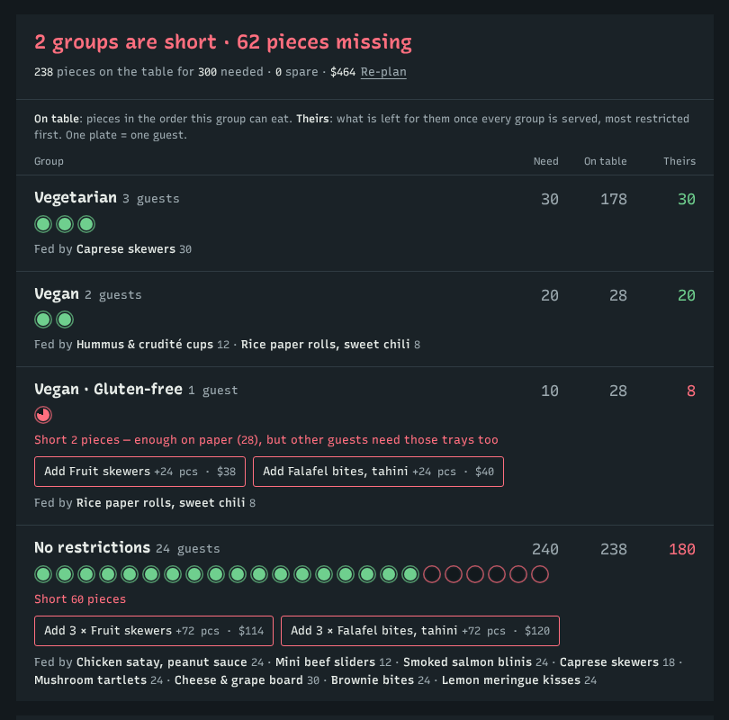

# TrayMath

**Party platters planned by diet.** A host enters how many guests are coming and who has restrictions; TrayMath builds a tray order from the caterer's menu, shares every tray's pieces out between the guest groups (most restricted first, so no tray is counted twice), shows who is short and by how much, and hands the caterer a kitchen ticket with printable table labels.

Live demo: https://traymath.pages.dev (fictional caterer "Juniper Table"; menu, prices and labels are sample data)



## Why

Catering enquiries arrive as "about 30 people, a few vegetarians, one gluten-free". A quick check ("we have 28 vegan pieces, the vegans need 20, the vegan gluten-free guest needs 10, fine") counts the same tray for two groups. TrayMath does the sharing out properly and shows two numbers per group:

- **On table**: pieces in the order this group can eat (the naive count)
- **Theirs**: what is left for them once every group is served

When "On table" is enough but "Theirs" is not, the row turns red and offers a fix ("Add Fruit skewers +24 pcs · $38").

## Try it

1. Open the live demo (or run it locally, below). The sample party is filled in: 30 guests, cocktail party, 3 vegetarian, 2 vegan, 1 vegan and gluten-free.
2. Press **Plan my trays**. Everyone is covered.
3. In the tray order, press − on *Fruit skewers* once and on *Falafel bites* twice. The vegan gluten-free guest still has 28 pieces on the table for the 10 they need, yet is short 2: the vegans need the same trays.
4. Press the suggested fix. Then **Send to caterer** → **Open the kitchen ticket** → **Print table labels**.

The whole order lives in the page address, so the link *is* the order. No server, no account, nothing stored.

## Run locally

Plain HTML, CSS and JavaScript modules. No build step, no dependencies.

```bash
python3 -m http.server 47811     # or: npx serve -l 47811 .
# open http://localhost:47811/
```

## Tests

```bash
npm test                                   # engine + link tests, Node 20 built-in runner
node tests/journey.mjs http://localhost:47811/ test-results   # browser journey (needs Playwright + Chromium)
```

`tests/engine.test.js` names each kernel acceptance criterion from `devpost/prd.md` (no double counting, restricted guests first, impossible groups, fixes close the gap, auto-plan coverage and variety). `tests/journey.mjs` runs the whole core journey in a browser, including the phone layout and the print view of the labels, and saves screenshots.

## How it works

- `src/engine.js`: compatibility rules and a max-flow allocation (source → trays → compatible groups → sink). Groups are connected most-constrained first; flow into a group never decreases afterwards, so restricted guests keep priority. Also `suggestFixes` and a greedy `autoPlan` with a variety pass and a trim pass.
- `src/menu.js`: the demo caterer's menu, party rules (pieces per guest) and labels.
- `src/order-link.js`: state ⇄ URL-safe code, strictly validated.
- `src/planner.js`, `src/ticket.js`, `src/view-helpers.js`: the two screens.
- `devpost/app-map.html`: a one-page map of the code, from one click to the result.

## Built with the Devpost Learn Skill Pack

Planned and built in Claude Code with [challengepost/learn-ai-basics](https://github.com/challengepost/learn-ai-basics) (MIT), skills `1-start` → `6-ship`, starting from an empty folder (see the first commit). Planning documents are in `devpost/`:

- [`devpost/scope.md`](devpost/scope.md): the kernel, who it's for, the proof-of-concept boundary
- [`devpost/prd.md`](devpost/prd.md): journey, behaviours, acceptance criteria
- [`devpost/spec.md`](devpost/spec.md): architecture, data model, failure modes
- [`devpost/checklist.md`](devpost/checklist.md): build slices, verification, and the plan revisions the build forced
- [`DESIGN.md`](DESIGN.md): the visual direction

No pre-existing code is included. Third-party: the Recursive font via Google Fonts (OFL).

## Boundaries

TrayMath plans servings from the caterer's own diet and allergen labels. It is not an allergy safety tool; cross-contact and kitchen practice are the caterer's to confirm, and the app says so on every screen that shows allergens.

## License

MIT
